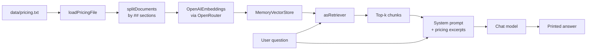

# RAG example 01 — Pricing Q&A

TypeScript CLI that answers construction/renovation pricing questions with **RAG** (Retrieval-Augmented Generation) over `data/pricing.txt`.

## Prerequisites

- Node.js 18 or newer
- An [OpenRouter API key](https://openrouter.ai/keys) (or OpenAI key for chat only; embeddings use OpenRouter in this project)

## Setup

```bash
cd rag-example-01
npm install
cp .env.example .env
# Edit .env and set OPENROUTER_API_KEY
```

## Run

One-shot question:

```bash
npm run dev -- "How much to remove a load-bearing wall?"
```

Interactive mode (type questions, Ctrl+C to exit):

```bash
npm run dev
```

Compiled build:

```bash
npm run build
npm start -- "How much for a bathroom demo?"
```

## Environment

| Variable | Description |
|----------|-------------|
| `OPENROUTER_API_KEY` | Required — embeddings + chat via OpenRouter |
| `OPENROUTER_MODEL` | Chat model (default: `openai/gpt-4o-mini`) |
| `OPENAI_API_KEY` | Optional alternative for chat if OpenRouter is unset |

## How it works



### Pipeline steps

1. **Load** — Read `data/pricing.txt` into a LangChain `Document`.
2. **Chunk** — Split on `##` section headers (and blank lines), with overlap so related lines stay together.
3. **Embed & index** — Embed each chunk with `text-embedding-3-small` (OpenRouter) and store vectors in an in-memory `MemoryVectorStore`.
4. **Retrieve** — For each question, pull the most similar chunks (default `k=1` in the agent wrapper).
5. **Generate** — Inject those chunks into the system prompt and ask the chat model to answer **only** from that reference (or say it does not know).

### Project layout

| Path | Role |
|------|------|
| `src/app.ts` | CLI: one-shot or interactive Q&A |
| `src/rag-pipeline.ts` | Load → split → embed → retriever |
| `src/pricing-qa-agent.ts` | Build RAG once, answer many questions |
| `data/pricing.txt` | Source of truth for prices |

Edit `data/pricing.txt` to change the knowledge base; restart the agent so embeddings rebuild.
